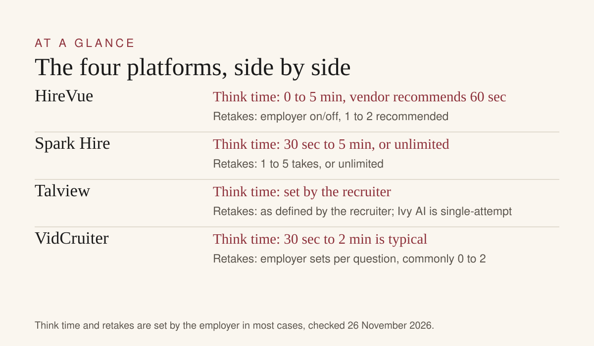
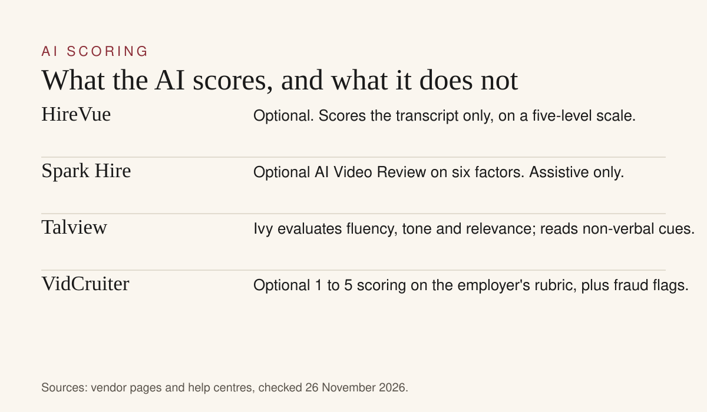

# One-Way Video Interviews Compared: HireVue vs Spark Hire vs Talview vs VidCruiter

*Last checked: 26 November 2026 · 12 min read*

> **How we compare.** Every platform in this comparison is scored on the same published rubric, no platform is ranked first by default, and no platform pays for placement here. Facts were checked on the vendors' own pages and candidate help centres on the date shown at the top, and the text says which source each claim comes from.

## Why this comparison exists

A one-way video interview is the strangest step in many hiring processes. You open a link, answer preset questions alone on camera, and a hiring team watches the recording later. There is no interviewer to read and no chance to ask a question back. The rules that matter most (how long you get to think, how long you can speak, whether you can re-record) are set by the employer, not by the platform, and they change from one invitation to the next, even on the same platform.

Four platforms run most of these interviews worldwide: HireVue, Spark Hire, Talview and VidCruiter. They look similar from the candidate's side, a link, a camera test, a countdown, but they differ in what the employer can configure, whether AI scores your answers, what the hiring team sees, and what the whole thing costs the employer.

## How we scored

Every platform is assessed on the same six criteria, the rubric published on our About page: **timing control** (what the employer sets, what you see before recording), **retakes** (whether you can re-record, and who decides), **AI scoring** (whether AI scores your answers, what it scores, how openly the vendor explains it), **what employers see** (recording, transcript, scores, proctoring flags), **practice available** (whether you can rehearse on the real platform before anything counts), and **price and billing model** (what the employer pays, because price decides which employers use which platform, and that decides which one you are likely to meet).

One thing none of these platforms does: hire you. Each is software the employer buys and configures. When this article says "HireVue allows retakes" it means the platform gives the employer a retake setting; your invitation may still allow none. Read your invitation and the instruction screen before each question. That screen outranks everything in this article.

## The comparison at a glance

| | HireVue | Spark Hire | Talview | VidCruiter |
|---|---|---|---|---|
| Think time | Employer sets 0 to 5 min; vendor recommends 60 sec | 30 sec to 5 min, or unlimited | Recruiter-defined | Employer sets per question; often 30 sec to 2 min |
| Answer length | Employer sets it; commonly 2 to 3 min | 30 sec to 3 min | Recruiter-defined | Employer sets per question; a minute or two typical |
| Retakes | Employer on/off; vendor recommends 1 to 2 retries | 1 to 5 takes, or unlimited; limited think time means one take only | Retries as defined by recruiter; Ivy AI interviews are single-attempt | Employer sets per question; commonly 0 to 2 |
| AI scoring | Optional. Scores the transcript only, five-level scale. No face, voice or body-language analysis | Optional AI Video Review on six factors (Communication, Execution, Comprehension, English proficiency, Enthusiasm, Motivation). Assistive only | Ivy (AI interviewer) evaluates fluency, tone, relevance, and can interpret non-verbal cues | Optional AI scoring 1 to 5 on the employer's rubric, plus transcripts, summaries, fraud flags |
| What employers see | Recordings, AI competency scores and a tier (top, middle, bottom) when AI scoring is on | Recordings, scores, shared scorecard; AI transcripts and summaries if enabled | Recordings, scores, AI reports, proctoring footage, candidate data | Recordings, structured scorecards, multi-rater scores, AI scores and summaries if enabled |
| Practice | Unlimited practice questions, unseen by anyone | Unlimited practice video, not saved or shared | Practice video assessment for proctored video assessments; none for live interviews | Practice question first, in common setups |
| Employer price | Not published; quote only. Third-party data puts entry tier at about $35,000/year | From $249/month billed annually ($299 monthly); published pricing | Not published; quote only (no figure verifiable) | Not published; quote only. Capterra lists about $5,000/year starting (not vendor-confirmed) |

*Prices and settings checked 26 November 2026 against the sources listed at the end. Vendors change pricing often; if a figure here is wrong, we correct it with a dated note (see our corrections policy).*

## HireVue: the enterprise default, and the most documented AI scoring

HireVue is the platform most candidates meet first, especially in graduate and early-career hiring. Its candidate FAQ says most video assessments have five to eight questions and take under 20 to 30 minutes, and it recommends setting aside 45 minutes. A typical AI-scored assessment is three to six video questions plus two to three games, taking about 15 to 25 minutes in total (HireVue's AI Explainability Statement).

The employer controls the settings that matter to you: preparation time (0 to 5 minutes, HireVue recommends 60 seconds), retries (on or off, 1 to 2 recommended), the number of questions, and whether AI scoring is used at all. Recording starts automatically when the preparation timer ends, and you cannot return to a question after submitting it. Before the real questions, HireVue offers practice questions you can take as many times as you like; nobody sees them.

HireVue's AI scoring is the most openly documented of the four. Its 2025 Explainability Statement describes three steps: a third-party speech-to-text system (Rev.ai) transcribes your answer; a language model HireVue calls CUSTARD, built on the RoBERTa model, reads the transcript for meaning; and a scoring model trained on expert human ratings (about 60 raters, 99,411 ratings across 19 competencies) places each answer on a five-level scale from Novice to Expert for the competency that question was written to test. The statement is explicit: the AI "relies only on what is said by the candidate and does not use any video analysis or other audio characteristics", so it does not assess facial expressions, body language, surroundings or tone of voice. That is HireVue's own claim, not an independent finding.

With AI scoring on, the recruiter sees your recordings alongside competency scores and an overall tier (top 67 to 100%, middle 36 to 66%, bottom 0 to 33%). Without it, the recruiter simply watches the recordings. An answer the system cannot read, typically under five understood words, is not scored and is flagged for human review.

## Spark Hire: the clearest screen, and the most forgiving retake rules

Spark Hire is the platform small and mid-size employers reach for first, and it shows in the candidate experience. Its candidate help centre describes a walkthrough before the real questions: a welcome video, tips, a tutorial, a camera and microphone test, and a practice video you can record, watch back and retake as often as you need. Practice videos are not saved or shared with the employer.

Before each question, Spark Hire shows you three settings, chosen by the employer: think time (unlimited, or 30 seconds to 5 minutes), takes (one to five, or unlimited) and the time limit (typically 30 seconds to 3 minutes). One catch, stated in the vendor's own documentation: when an employer limits think time, you are also limited to one take, and recording starts automatically when the timer ends. After each recording you watch the playback, then submit, retake if you have takes left, or skip the question. The employer does not see how many attempts you used, according to independent guides based on Spark Hire's own pages, so a retake costs you nothing in the reviewer's eyes. You can pause and come back through the same link as long as you submit before the deadline.

Spark Hire's AI is optional and narrower than HireVue's. Its AI Video Review scores responses on six factors (Communication, Execution, Comprehension, English proficiency, Enthusiasm and Motivation). The vendor states the AI is assistive and does not make hiring decisions, and that a human reviews your video. Unlike HireVue, Spark Hire does not publish a detailed explainability statement describing how its scores are produced, so we cannot say more about the method than the vendor itself says.

Spark Hire is the only platform here with published employer pricing: video interviews from $249 a month billed annually, or $299 a month on monthly billing (capped at 5 active jobs and 5 users), with unlimited one-way and live interviews on every plan. Candidates use Spark Hire for free.

## Talview: AI interviewer and proctoring, in one platform

Talview is really three products under one name, and your invitation may be any of them. Its candidate FAQ distinguishes asynchronous interviews, live interviews and Ivy AI interviews, and the experience differs sharply between them.

In an **asynchronous interview**, you record video or audio answers to preset questions, each with a time limit and retries as defined by the recruiter. In a **live interview**, you meet an interviewer in real time. **Ivy** is different again: Talview's AI interviewer asks you questions by voice, records your answers and evaluates communication traits such as fluency, tone and relevance. Talview's FAQ says Ivy asks every candidate identical questions, and its product page adds that Ivy asks contextual follow-ups. Unlike HireVue's AI, which scores only the transcript, Talview says Ivy interprets non-verbal cues, so how you come across on camera is part of what it records.

Talview is also a proctoring company, and that shapes the candidate experience more than on any other platform here. In proctored assessments, your camera, microphone and screen may be recorded for identity verification and integrity checks, starting only after you grant permission, and denying camera or microphone access blocks async and Ivy interviews from starting. If you close the browser mid-assessment, progress auto-saves up to the last completed question, but the timer keeps running even if you lose connectivity. Retakes are not automatic: if something goes wrong, your recruiter decides whether to reassign the test.

What the employer sees is the broadest package of the four: your responses, scores and recordings, AI evaluation reports if configured, proctoring footage, and your personal data (name, email, candidate ID and test logs). Talview says this data is shared solely for hiring and evaluation and is deleted after the retention period your organisation defines; you can request deletion before then through your recruiter or by emailing privacy@talview.com. Talview publishes no employer pricing that we could verify, and we found no reliable third-party figure either, so we do not quote one.

## VidCruiter: structured scoring and the audit trail

VidCruiter is the platform you are most likely to meet in government, healthcare, education and other regulated hiring, where every step of the evaluation needs to be documented. Its core idea is structured interviewing: every candidate answers the same questions, and every reviewer scores against the same rubric.

In a pre-recorded VidCruiter interview, the employer sets thinking time, recording time, the number of attempts and a review timer for every question, and your invitation and the screen before each question tell you the actual values. Candidate reports describe a short prep countdown, then a fixed answer window, typically a minute or two for behavioural questions, that auto-submits when it hits zero. Retakes are entirely the employer's choice: some postings allow none, some allow one or two per question, and independent guides commonly report two as typical, but there is no VidCruiter default to rely on. You review your recording before submitting, and re-record if you still have attempts left. Unlike Spark Hire, you generally cannot pause and come back mid-question; leaving the tab or closing the browser typically forfeits that attempt.

VidCruiter's AI is newer and narrower than HireVue's. Its AI can score recorded answers on a 1 to 5 scale tied to the employer's approved rubric, generate interview questions and rating guides, write interview notes and summaries, produce searchable transcripts in English and French, and flag candidate fraud such as impersonation or someone helping off camera. The vendor positions these features as assistive: automated scoring is subject to recruiter review, and live interviews are not AI-scored. The platform's long-standing strength is human structured review: multi-rater scoring, where several reviewers independently score the same response against a shared scorecard, and a complete audit trail of who scored what.

VidCruiter publishes no employer pricing. Its pricing page lists nine modules you can buy (pre-recorded interviews, live interviews, scheduling, reference checks, skills testing and more), all quote-based. Third-party listings report a starting price of about $5,000 a year, which we could not confirm with the vendor, so treat it as reported, not verified. Reviewers on G2 report an average of two months to implement VidCruiter: organisations willing to run setup as a project, not teams buying a tool for one hire.

## Your rights: AI scoring, notice and accommodations

Two US jurisdictions have written rules that directly cover AI-scored video interviews, and they are worth knowing even if you apply elsewhere, because employers increasingly apply the same notice practices globally.

**Illinois** has required, since 1 January 2020, that an employer using AI to analyse a recorded video interview must tell you beforehand, explain how the AI works and what general characteristics it evaluates, and get your consent. It may not use AI on applicants who do not consent, and you can ask for the videos to be deleted within 30 days. Since 1 January 2026, the state's Human Rights Act also treats AI use with a discriminatory effect in job decisions as a civil rights violation and requires notice when AI is used.

**New York City's** Local Law 144, enforced since July 2023, requires employers using an automated employment decision tool to have a bias audit from the past year, publish a summary of the results, and notify candidates who live in the city at least 10 business days before using the tool. A December 2025 audit by the New York State Comptroller found enforcement had been weak, with only two complaints received in two years.

Elsewhere, the picture is thinner: there is no general right, anywhere in the US, to a human instead of software, and the EU's AI Act and GDPR add their own transparency duties for employers hiring in Europe. This is general information, not legal advice.

On accommodations, all four vendors say the employer decides, and all four provide a route to ask: HireVue's interview has a built-in request for extra time on timed questions, and Talview's FAQ says to inform your recruiter in advance. Ask early, in writing, before your deadline, and keep the employer's reply.

## How to prepare for each one

The format rewards the same preparation on every platform, with one adjustment per platform. On every platform: read the invitation and the instruction screen before each question, it lists your think time, answer limit and retakes for that question. Use the practice question or practice video, which is free and unseen on all four. Keep answers to 60 to 90 seconds, structured (situation, task, action, result), and finish with the result before the timer ends.

- **HireVue:** assume no retakes unless the screen says otherwise, and remember the AI scores the transcript, not your face. Keep notes beside you; HireVue's own guidance allows it.
- **Spark Hire:** check the three settings before each question. If think time is limited, you get one take and recording starts automatically, so have your stories ready before you press start. If think time is unlimited, use it: jot down four STAR points, then record.
- **Talview:** work out which format you have (async, live or Ivy) before you prepare. For Ivy, rehearse follow-ups, not just first answers, because Ivy asks contextual follow-ups. Mute your mic for 2 to 3 seconds after finishing, as Talview suggests, so Ivy can process your answer. Do not switch apps or check your phone during the session.
- **VidCruiter:** treat the timer as a hard cap and rehearse stopping cleanly when it ends. Read the instructions screen at the very start: it usually states the retake count explicitly. Do not leave the tab mid-question.

## Practising before it counts

Every platform gives you a free rehearsal on its own interface, and that is the single most useful preparation there is, because the format shock (the countdown, the auto-start, the silence) is what practice fixes.

Dedicated one-way video interview practice tools exist too. Candidate Falcon, which also appears in our HireVue game prep comparison, sells video-interview practice plans from €19.99 a month, with AI feedback on your recorded answers, and combined games-plus-interview plans from €36.99 a month (vendor's pricing page, checked 26 November 2026). It is scored here on the same terms as any other prep option: useful if your process pairs a HireVue game assessment with a one-way interview, and overkill if your invitation is a single short interview on one platform.

## Which one will you meet?

Which platform you meet says more about the employer than about you. A large graduate employer running thousands of applications will usually be on HireVue or Talview, where AI scoring and proctoring scale. A startup or mid-size company screening a handful of roles will usually be on Spark Hire, where the price is published and the buying is self-serve. A government agency, hospital or university will usually be on VidCruiter, where the audit trail matters more than the price.

None of the four is objectively the hardest. The hardest interview is the one whose settings you did not read: a HireVue with no retakes and a 30-second prep window, a Spark Hire with limited think time and one take, an Ivy interview you expected to be a recording, a VidCruiter question you left mid-answer. Read the screen, use the practice question, and answer the question that was asked, in words a transcript can score.

## Sources (all checked 26 November 2026)

- HireVue candidate FAQ and preparation guide (hirevue.com): question counts, timings, practice questions, employer-set settings.
- HireVue AI Explainability Statement (2025): transcript-only scoring, CUSTARD/RoBERTa, Rev.ai transcription, 19 competencies, five-level scale, 99,411 expert ratings, prep 0 to 5 min, 1 to 2 retries recommended, tier bands, five-word scoring floor.
- Spark Hire candidate help centre (sparkhire.com): walkthrough, practice video, think time/takes/time limit, limited think time means one take, pause and resume.
- Spark Hire pricing page, via independent pricing guides that read it in Oct-Nov 2026: video interviews from $249/month billed annually, $299 monthly, 5 jobs and 5 users on monthly.
- Spark Hire AI Video Review, via independent guides based on Spark Hire's own pages (recruitingtechreviews.com, colloqa.ai, huru.ai): six scoring factors, assistive only, human decision, employer does not see attempt count.
- Talview Candidate Assessment FAQs (docs.talview.com): assessment types, async limits and retries, Ivy traits, practice assessment, timer on disconnect, proctoring, data sharing, deletion, accommodations.
- Talview Ivy, via independent guides (copilotinterview.com, ntrvsta.com): identical questions with contextual follow-ups, non-verbal cues, time-bound single-attempt sessions.
- VidCruiter applicant support centre and pre-recorded interview page, via independent guides that read them in Oct 2026 (copilotinterview.com, asynchronousinterview.com, aceround.app): per-question employer settings, review before submitting, disconnect behaviour, structured scorecards.
- VidCruiter AI features and pricing, via independent reviews (selectsoftwarereviews.com, techshark.io, hirevire.com, whatjobs.com): AI scoring 1 to 5 on the employer's rubric, transcripts, fraud detection, no published price, Capterra starting price about $5,000/year, G2 implementation average 2 months.
- HireVue employer pricing, via third-party procurement data (pin.com, sprad.io, happyrobot.ai): no published prices, entry tier about $35,000/year, average contract about $49,855/year (Vendr), implementation $15,000 to $40,000.
- Illinois AI Video Interview Act (820 ILCS 42) and Illinois Human Rights Act AI provisions (775 ILCS 5/2-102(L)), via legal guides (fairbydesign.org, reacit.com, digitalstorming.com, boostpoint.com): notice, explanation, consent, deletion within 30 days, effective dates.
- New York City Local Law 144, via NYC DCWP guidance and the Dec 2025 NY State Comptroller audit, as reported by fairbydesign.org and reacit.com: annual bias audit, public summary, 10 business days' notice, weak enforcement.
- Candidate Falcon pricing page (candidatefalcon.com/pricing): video-interview practice from €19.99/month, combined plans from €36.99/month.

*Corrections: if any figure in this article is wrong or out of date, tell us and we will fix it with a dated note, not a silent edit.*
